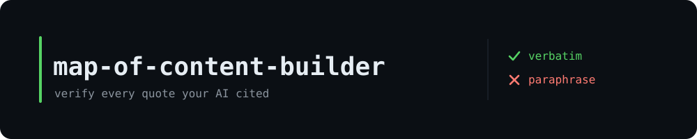
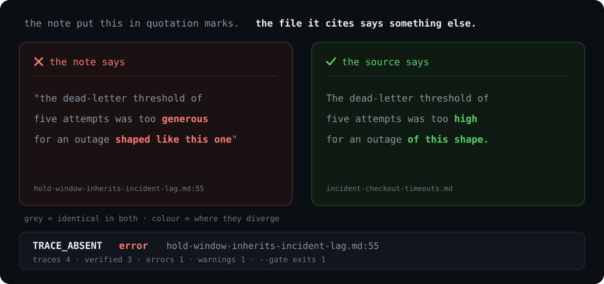
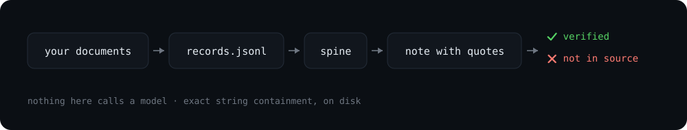

<p align="center"></p>

**Every quotation in an AI-written note, checked against the bytes of the file it cites.**

[](LICENSE)
[](https://www.python.org/downloads/)
[](profiles/default.profile.yaml)

## Quickstart

No config, no API key, no network.

```bash
pip install pyyaml
python3 scripts/lint_corpus.py --corpus examples/demo-corpus --profile profiles/default.profile.yaml
```

```
pages 1 · records 4 · traces 4 · verified 3 · 1 error · 1 warning · exit 0
```

Both findings are planted, both are real. Add `--gate` for CI: same provenance checks, exit 1 on any error.

## What it does

Builds a map of content over a folder of documents, then pulls every quoted span out of the generated pages and tests it for exact string containment in the source file that page cites. Deterministic Python — no model calls, no embeddings, no network.

<p align="center"></p>

## What it catches

| What the note claims | What the source actually says |
|---|---|
| "the dead-letter threshold of five attempts was too **generous** for an outage **shaped like this one**" — cited to `incident-checkout-timeouts.md` | "The dead-letter threshold of five attempts was too **high** for an outage **of this shape**." |
| "The hold period is bounded by the worst consumer lag we have measured" — cited to `decision-blue-green-deploys.md`, locator `H:context` | The same sentence, verbatim — filed under a different heading entirely |

Row one is `TRACE_ABSENT`, an **error**: same meaning, different words, quote marks not earned. Row two is `TRACE_LOCATION`, a **warning**: right source, wrong address. Collapsing those two severities is how a checker gets muted.

## The finding

On one real 39-page AI-generated corpus there were 448 quoted snippets and **116 did not occur verbatim** in the source they cited — 26%. On the page that was hand-checked, all 5 failures were close *paraphrases*, not inventions (longest verbatim runs 9-of-10, 6-of-9, 6-of-10, 4-of-7, 4-of-7 words), and every underlying claim held up.

**This is a provenance defect, not a truth defect.** A failure means *this quotation is not verbatim*. It never means *this claim is false*.

## How it works

<p align="center"></p>

| Mode | |
|---|---|
| `scaffold` | Creates the corpus tree and its config. Human-owned files are written once, never overwritten. |
| `ingest` | Normalizes each source into a JSONL record with a content hash and a resolvable evidence path. |
| `relate` | Proposes candidate page pairs from shared entities, tags and links. No score, no suggested relation. |
| `lint` | Audits the corpus against a declarative profile, writes one report outside it, edits nothing. |

Only two tiers ever return VERIFIED — `exact` and `normalized` (NFKD + casefold + whitespace collapse); fuzzy matching is a hint attached to a failure, never a pass. Full details in [`docs/how-it-works.md`](docs/how-it-works.md), demo walkthrough in [`examples/README.md`](examples/README.md).

## What it does not do

- **It cannot tell you a verbatim quote supports the claim attached to it.** String existence is not entailment; quote-mining passes every check here.
- **It needs the sources on local disk.** No URL fetching, no network anywhere in it.
- **It does not fix anything.** No `--fix`, no suggested patch. It reports; the edit stays a human decision.
- **It is not a RAG evaluator.** Exact string verification against a named file, not LLM-as-judge scoring or semantic similarity.

## Use it with Claude Code

`SKILL.md` at the repo root is the agent layer: mode routing, the exact commands, the trace rules
and the refusal conditions. Claude does not discover it from a clone — skills are loaded from
`~/.claude/skills/<name>/SKILL.md`. Point that at the repo once:

```bash
ln -s "$(pwd)" ~/.claude/skills/map-of-content-builder
export MOC="$(pwd)"            # SKILL.md resolves every script through $MOC
```

Then "build a MoC over this folder" or "audit the corpus" routes to the right mode. The scripts
still run locally and make no model calls, so the agent is doing judgement work only: naming
buckets, writing gists, drafting relationship pages, and reading the lint report for the semantic
checks the linter deliberately refuses to decide.

## Tune it

Every threshold, tier list, token bound, severity and vocabulary lives in [`profiles/default.profile.yaml`](profiles/default.profile.yaml) and in no `.py` file. Copy it, edit it, pass it with `--profile`. A profile may lower a severity; it can never raise one above the ceiling the code declares.

## License

MIT — see [LICENSE](LICENSE).

---

⭐ If you have ever taken an AI-written citation on trust, star this and go check one.
